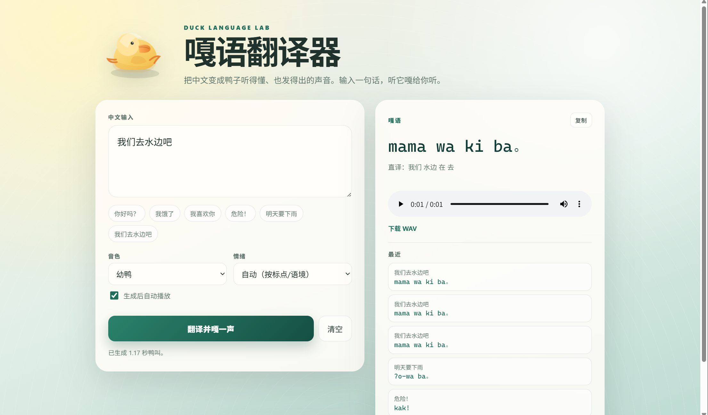

# 嘎语翻译器

> 把中文变成鸭子听得懂、也发得出的声音。

嘎语翻译器是一个中文到**嘎语**（鸭子语）的翻译器。它不是把每个字换成“嘎”，而是先把一句话拆成鸭子能理解的日常意思，再用一门为鸭子设计的迷你语言重新表达，最后用程序化合成的声音真的“嘎”出来。



## 它是什么

嘎语是一门刻意受限的语言：词汇少、句子短、只谈眼前的事。翻译器负责把中文压进这套限制里，发声器负责把鸭语文本变成鸭子叫声。

- **翻译和发声同源**：鸭语文本和音频由同一套音节序列驱动，改一个词就能听到对应变化
- **真的能叫**：不是人类 TTS 读拼音，而是用共振峰合成的鸭子叫声
- **完全离线**：不需要云端 TTS，也不需要大模型
- **三种玩法**：命令行、REPL、Web 页面

## 能做什么

- 中文到嘎语翻译，附带逐词直译
- 四种音色：幼鸭、成鸭、愤怒鸭、温柔鸭
- 五种情绪：平静、疑问、兴奋、警报、温柔
- 未收录词自动转写成合法鸭语音节，并标上借词记号
- 输出 44.1kHz / 16-bit 单声道 WAV
- CLI、Web API 和 Python API 都可以直接调用

## 翻译示例

| 中文 | 嘎语 | 直译 |
| --- | --- | --- |
| 你好吗？ | `na wi ha?` | 你 好 吗 |
| 我饿了 | `ma mam ʔi` | 我 食物 要 |
| 我喜欢你 | `ma na wi` | 我 你 喜欢 |
| 危险！ | `kak!` | 危险 |
| 明天要下雨 | `ʔo-wa ba` | 下雨 将 |
| 我们去水边吧 | `mama wa ki ba` | 我们 水边 在 去 |

## 快速开始

需要 Python 3.11+ 和 [uv](https://docs.astral.sh/uv/)。

```bash
cd D:\duck-lang
uv sync
uv run duck-web
```

浏览器打开 `http://127.0.0.1:8000`，输入中文，点“翻译并嘎一声”。

命令行也可以直接玩：

```bash
uv run duck "你好吗？"
uv run duck --voice duckling "我饿了"
```

## 文档

- [完整使用指南](USAGE.md)：CLI、Web、Python API、音色、词典扩展、测试和常见问题
- [设计方案](方案设计.md)：音系、语法、翻译流程和发声实现

## 设计原则

嘎语的关键是“限制即可爱”：词汇少、句子短、只谈眼前。鸭子说不出复杂的人话，但能约饭、告警、表达亲昵，也能用音高和身体朝向补足语法。

## 技术栈

Python · uv · jieba · numpy · FastAPI · 程序化共振峰合成

## 状态

当前是规则翻译，优先覆盖日常表达。复杂书面语可能拆分得不完美；未收录词会借词化并提示，不会直接崩溃。
